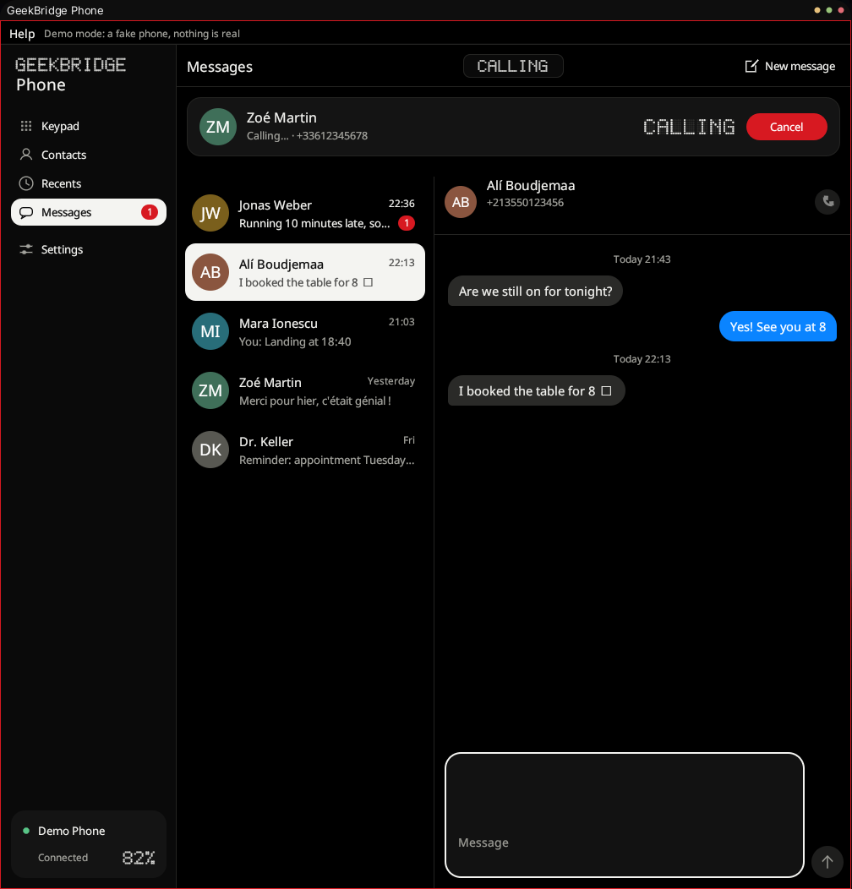
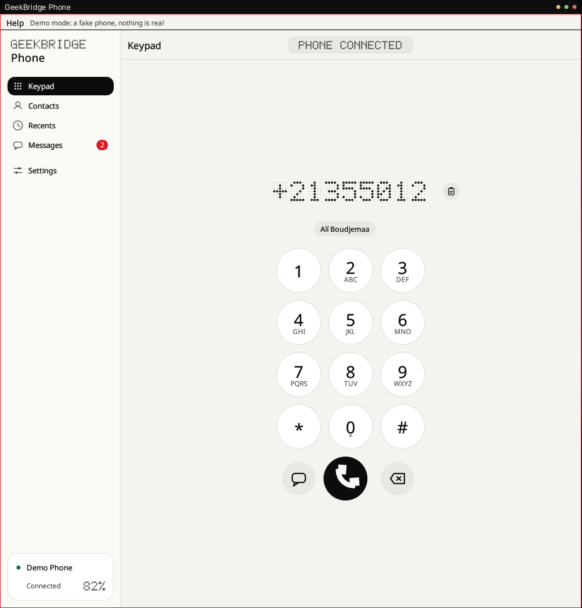
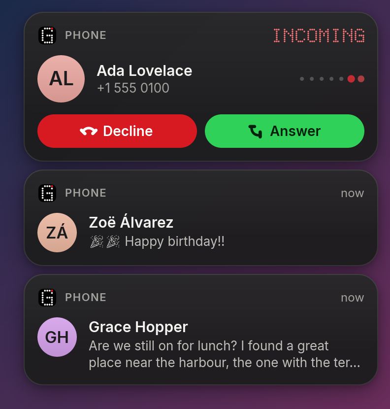
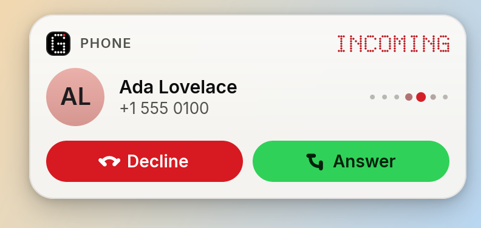

# GeekBridge Phone

**Your phone, on any computer. No app on the phone, no account, no cloud.**

On a Mac with an iPhone, a call rings on the screen and you answer it right there. Texts arrive as banners you can reply to. That should not depend on which brand of phone is in your pocket or which operating system is on your desk.

GeekBridge Phone brings that to **Android and iPhone, on Linux today, with Windows and macOS next**. A call or text appears in the top-right corner of your screen like a native notification: answer or decline the call, read the text, reply on the spot. It uses only the Bluetooth features every phone already has, the same ones a car uses. Nothing is installed on the phone, and nothing leaves the link between your phone and your computer.

<p align="center">
  
  
</p>
<p align="center">
  
  
</p>

<sub>Screenshots use a demo phone with invented people (`geekbridge-phone --demo`).</sub>

## Why this exists

Phones and computers should work together whatever you buy. Today the smooth experience is sold as part of one company's ecosystem, and everyone else gets a lock-in or a cloud account in exchange. But the pieces have always been open: calls, contacts and messages travel over **standard Bluetooth profiles** that cars, headsets and every phone have spoken for years. Nobody has built the friendly desktop side for all phones and all operating systems.

So that is the goal:

- **Any phone.** Android and iPhone, the same app, the same banners.
- **Any computer.** Linux now; Windows and macOS are the next ports.
- **Your data stays yours.** No account, no server, no telemetry. It all stays on your Bluetooth link and your disk.
- **Nothing to install on the phone.** The phone already thinks your computer is a car.
- **Open and small.** GPL-licensed, written in Rust, one lightweight program.

It looks the way we think a phone companion should: macOS-style banners and dot-matrix type (true black or warm off-white, one red accent), in both light and dark.

> **Status: 0.1.x, Linux.** Verified on real hardware: a Samsung Galaxy Z Fold5 (Android 17) and an iPhone. The OS-independent core builds and passes its tests on **Windows and macOS** in CI. The Windows and macOS platform layers are next ([docs/PORTING.md](docs/PORTING.md)).

## What it does

| | |
| --- | --- |
| **Calls** | Incoming-call banner with Answer / Decline, dial from the keypad or contacts, hang up, call timer, missed-call and history list. Your voice goes through the computer's speakers and microphone. |
| **Texts** | Read and send SMS, conversations like iMessage, a notification banner with **quick reply**. Your history is kept on this computer. |
| **Contacts** | Your phone's contacts and call history, searchable by name, number or keypad letters. |
| **Recording** | Optional call recording (off by default): both sides saved as one stereo WAV, the other person on the left. Recording a call may require the other person's consent where you live. |
| **Calls only** | The phone's music and videos stay on the phone. By default the Bluetooth link is used for calls, not as a speaker. |
| **Updates** | The app updates itself from this repository's releases, with a checksum and signature check. |

## Works with

| | Android | iPhone |
| --- | --- | --- |
| Calls: banner, answer, decline, hang up, talk through the computer | Verified | Verified |
| Contacts and call history | Verified | Verified (needs *Sync Contacts*) |
| Reading texts | Verified | Verified (needs *Show Notifications*) |
| Sending texts | Verified | Not verified: Apple lets cars send texts only by voice, so expect a refusal |
| Quick reply from the banner | Verified | Depends on sending |

Verified means tested on a real phone. Other phones should behave the same, since they speak the same standard profiles, but we have only tested the ones above.

| Computer | Status |
| --- | --- |
| **Linux** (BlueZ + PipeWire) | Works today |
| **Windows** | Next. The core already passes its tests on Windows in CI. |
| **macOS** | After Windows. The core already passes its tests on macOS in CI. |

## Setting up

### Android

1. Pair the phone with the computer in the system's Bluetooth settings.
2. Start **GeekBridge Phone**. The phone chip in the sidebar shows its name and battery.
3. The first time, the phone asks to allow access to **messages** and **contacts**: tick "always allow".

### iPhone

1. Pair the iPhone with the computer in the system's Bluetooth settings.
2. On the iPhone open **Settings > Bluetooth**, tap the **ⓘ** next to your computer, and switch on **Show Notifications** (texts) and **Sync Contacts**.
3. Start **GeekBridge Phone**. Calls, contacts and texts appear within moments.

Pairing is a one-time step, done by your operating system, not by the app. After that the phone reconnects on its own whenever it is nearby, like a car.

## Requirements (Linux)

- **BlueZ** and **PipeWire 1.4+** with its telephony module (Fedora 42+, Arch, Ubuntu 25.10+, Debian 13, openSUSE Tumbleweed), and a Bluetooth controller in the computer.
- Top-right banners need a Wayland compositor with `wlr-layer-shell` (Hyprland, Sway, KDE, river, niri, ...). On GNOME the app falls back to ordinary notifications.

## Install

From a release: unpack the tarball and run `./scripts/install.sh` (per user, no root; it starts a background service). From source:

```sh
cargo build --release -p phone-app
./scripts/install.sh
```

Uninstall with `./scripts/install.sh --uninstall` (your data stays in `~/.local/share/geekbridge-phone`). After that the app keeps itself up to date.

## Troubleshooting

- **"Allow message access on your phone"**: open the phone's Bluetooth entry for your computer and enable *Messages* and *Contacts* (iPhone: *Show Notifications* and *Sync Contacts*).
- **No calls**: calls need the phone connected for *hands-free*. Check the phone's Bluetooth entry for your computer, and that PipeWire's telephony service has the phone: `busctl --user call org.pipewire.Telephony /org/pipewire/Telephony org.freedesktop.DBus.ObjectManager GetManagedObjects`.
- **Texts stop arriving after a while**: a phone allows one message session at a time. Close other apps that read messages over Bluetooth.
- **The phone's music plays on the computer**: switch on *Settings > Calls > Calls only* (on by default).
- **Call recording**: the app records the phone's voice stream from PipeWire (`pw-record`, from `pipewire-utils`). Run `cargo run -p phone-linux --example rec_probe -- <phone address>` during a call to see whether the stream is found.
- **Contacts are empty**: the phone has not been allowed to share them (see the setup steps above); press *Reload* in Contacts afterwards.

## Privacy

Everything stays on the Bluetooth link between the phone and this computer. Contacts, call history and your text history are cached in a small SQLite database (`cache.db`, owner-only) under `~/.local/share/geekbridge-phone`, so the app starts instantly and does not re-read everything from the phone. Nothing is sent anywhere else and there is no telemetry. The only network access is the optional update check (below).

## Updates

The app updates itself from this repository's GitHub releases (*Settings > Updates*, on by default, about once a day; or `geekbridge-phone --check-update` / `--update`). It talks only to `api.github.com` and GitHub's release download hosts, over HTTPS, sends nothing about you, and installs a release only after checking both its SHA-256 checksum **and** an Ed25519 signature against the public key built into the app. The previous program is kept as `geekbridge-phone.previous` for a manual rollback. Turn the check off in Settings, or set `"check_updates": false` in `~/.config/geekbridge-phone/settings.json`. Installs managed by a package manager are left to it. How releases are made: [docs/RELEASING.md](docs/RELEASING.md).

## Roadmap

- **Windows**: the platform layer for phones, message and phonebook streams, and call control, plus the corner banners. [The plan](docs/PORTING.md).
- **macOS**: the same, with Apple's Bluetooth frameworks.
- **More than one phone at a time**, and quick switching between them.
- **More of the ecosystem**: shared clipboard and file drop are not part of calls and texts over Bluetooth, and would need another link.

Ideas and ports are welcome: see [CONTRIBUTING.md](CONTRIBUTING.md).

## How it is built

A Rust workspace:

- `phone-obex`: a portable OBEX client with MAP (texts) and PBAP (phonebook). No OS code.
- `phone-core`: call tracking, contacts, conversations, settings, storage and the background service. No OS code.
- `phone-linux`: the Linux platform: BlueZ and PipeWire telephony over D-Bus, RFCOMM sockets, SDP.
- `phone-overlay`: the corner banners (a platform-neutral renderer plus a Wayland layer-shell presenter).
- `phone-app`: the egui application.
- `phone-update`: the self-updater (GitHub releases, checksum and signature verification, atomic install).

See [ARCHITECTURE.md](ARCHITECTURE.md) for the design and [docs/PORTING.md](docs/PORTING.md) for Windows and macOS.

## Development

```sh
cargo test --workspace --all-features
cargo clippy --workspace --all-targets --all-features -- -D warnings
cargo fmt --all -- --check
cargo run -p phone-app --features demo -- --demo   # a fake phone with invented data
./scripts/check-portable.sh                         # type-check the portable crates for Windows and macOS
```

## Licence and credits

GPL-3.0-or-later, see [LICENSE](LICENSE). The visual design system (palette, dot-matrix engine) comes from the GeekBridge desktop apps by the same author.
